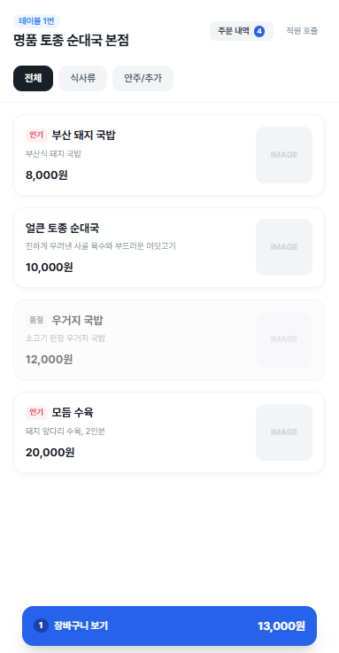
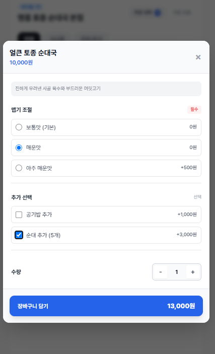
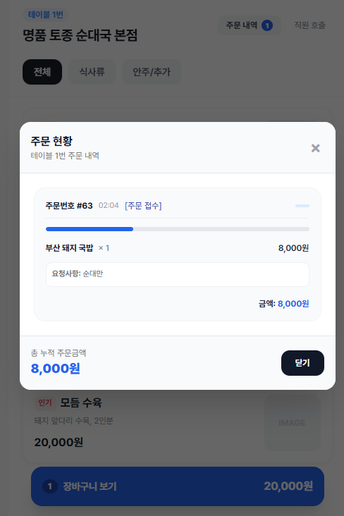
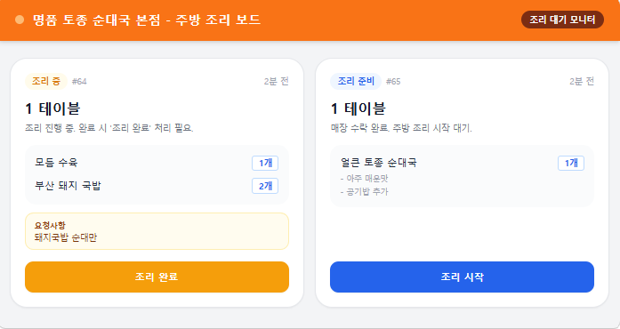
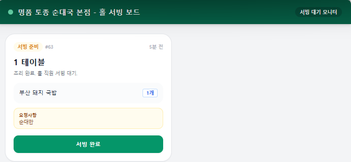
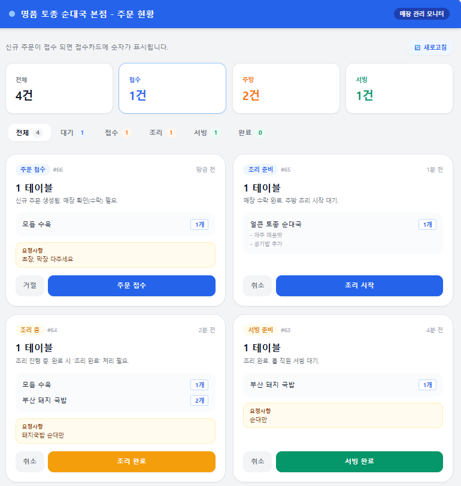

# QR Order

**테이블 QR 하나로 주문부터 서빙, 마감까지.**
직원 호출 없이 손님이 직접 주문하고, 주방과 홀이 같은 화면을 보며 움직이는 매장용 주문 관리 서비스입니다.

---

## 이런 고민, 있으셨나요?

- 피크 타임에 주문 받으러 다니느라 홀이 정신없다
- 주문서를 주방에 전달하다 빠뜨리거나 잘못 전달된다
- 조리가 끝났는데 홀에서 모르고 음식이 식는다
- "그 테이블 주문 나갔나요?"를 계속 물어보게 된다
- 테이블 오더를 들이고 싶은데 단말기 비용과 결제 수수료가 부담된다
- 인원을 늘리지 않고도 회전율을 높이고 싶다

QR Order는 이 문제를 **주문 접수 → 조리 → 서빙 → 정산** 한 줄의 흐름으로 정리합니다.
앱 설치도, 단말기 구매도 필요 없습니다. 가지고 계신 태블릿이나 PC 브라우저면 충분합니다.

---

## 주문이 흐르는 방식

```
손님 QR 주문 → 매장 접수 → 주방 조리 → 조리 완료 → 홀 서빙 → 테이블 정산(마감)
```

각 단계는 담당자 화면에만 해당 버튼이 나타납니다. 다음 사람이 해야 할 일이 자동으로 넘어가기 때문에 구두 전달이 필요 없습니다.
한 화면에서 처리하면 다른 화면에도 바로 반영됩니다.

---

## 화면 소개

### 1. 손님 주문 화면 (모바일)

테이블에 붙은 QR을 스캔하면 앱 설치 없이 바로 열립니다.

- 카테고리별 메뉴 탐색 (가로 스크롤 칩)
- 메뉴별 옵션 선택, 필수 옵션 누락 시 안내
- 장바구니에서 수량 확인 후 요청사항과 함께 주문
- 품절 메뉴는 클릭이 막히고 "품절" 표시, 인기·추천·NEW 배지 표시
- 내 테이블의 주문 내역과 진행 상태 실시간 확인
- 로그인, 회원가입, 개인정보 입력 없음

<table align="center" class="gallery">
  <tr>
    <td align="center"></td>
    <td align="center"></td>
    <td align="center"></td>
  </tr>
  <tr>
    <td align="center"><sub>메뉴 탐색<br>(인기, 품절 표시)</sub></td>
    <td align="center"><sub>옵션 선택과<br>실시간 금액 계산</sub></td>
    <td align="center"><sub>주문 진행 상태와<br>누적 주문금액 확인</sub></td>
  </tr>
</table>

### 2. 주방 보드

- 접수된 주문만 카드로 표시되고, 새 주문은 바로 나타남
- 테이블 번호, 메뉴, 수량, 옵션, 요청사항을 한눈에 확인
- **조리 시작 → 조리 완료** 두 번의 터치로 상태 변경
- 조리가 끝나면 "서빙 처리 중입니다"로 바뀌어 중복 조작 방지

<p align="center">
  
  <br><sub>주방 조리 보드: 조리 시작, 조리 완료 버튼만 표시</sub>
</p>

### 3. 홀 서빙 보드

- 조리 완료된 주문이 자동으로 나타남
- **서빙 완료** 버튼 한 번으로 처리
- 조리 중인 주문은 "주방에서 처리 중입니다"로 표시되어 진행 상황 파악

<p align="center">
  
  <br><sub>홀 서빙 보드: 조리가 끝난 주문만 서빙 완료 버튼과 함께 표시</sub>
</p>

### 4. 매니저 대시보드

- 상단 현황 카드: 전체 / 접수 / 주방 / 서빙 건수 실시간 집계
- 단계별 필터 탭으로 원하는 주문만 모아보기
- 접수, 거절, 취소를 한 화면에서 처리
- 변경 사항 실시간 반영

<p align="center">
  
  <br><sub>매니저 대시보드: 현황 집계, 단계별 필터, 접수·취소·마감 처리를 한 화면에서</sub>
</p>

### 5. 매장 관리 (매니저)

- **테이블 정산**: 테이블별 주문 합계를 메뉴별로 확인하고, 서빙이 끝난 테이블을 한 번에 마감. 오늘 매출 요약
- **메뉴 관리**: 카테고리, 메뉴, 옵션 그룹(단일/추가 선택, 필수 여부) 등록과 수정. 품절·숨김·인기·추천·NEW를 버튼 하나로
- **테이블 관리**: 테이블 추가와 번호 변경, 테이블별 주문 일시 중지, QR 이미지 저장·전체 인쇄·재발급
- **직원 PIN**: 관리자·주방·홀 역할별 4자리 PIN. 기본 PIN은 관리자 첫 로그인 때 변경

---

## 핵심 장점

| | |
|---|---|
| **역할별 화면 분리** | 주방, 홀, 매니저가 각자 할 일만 보입니다. 잘못 누를 일이 줄어듭니다. |
| **실시간 동기화** | 한 곳에서 처리하면 다른 화면에 자동 반영됩니다. |
| **중복 처리 방지** | 두 직원이 동시에 같은 주문을 눌러도 한 번만 처리되고, 화면은 최신 상태로 맞춰집니다. |
| **권한 관리** | 상태 변경 권한을 서버에서 검증합니다. 홀 직원이 마감 처리를 하는 등의 실수를 막습니다. |
| **설치 불필요** | 손님은 QR만 찍으면 되고, 직원 화면은 브라우저(태블릿, PC)에서 바로 사용합니다. |
| **결제 수수료 없음** | 앱 안 결제가 없는 후불 매장용입니다. 계산은 지금처럼 카운터에서 합니다. |
| **취소 대응** | 주문 거절, 취소 상태가 카드에 명확히 표시되어 혼선이 없습니다. |

---

## 이런 매장에 잘 맞습니다

- 식당, 국밥집, 분식점 등 **자리에 앉아 주문하는 후불 매장**
- 주방과 홀이 분리된 매장
- 점심 피크에 인력이 부족한 매장
- 주점처럼 추가 주문이 잦은 매장

**아직 맞지 않는 매장**: 주문할 때 먼저 결제하는 선불 매장, POS와 자동 연동이 필수인 매장, 인터넷 연결이 불안정한 매장

---

## 도입 방법

1. **도입 문의**: 메일로 매장 이름과 테이블 수를 알려 주세요.
2. **매장 코드 발급**: 확인 후 매장 코드와 관리자 접속 방법을 보내 드립니다.
3. **메뉴 등록 · QR 인쇄**: 메뉴와 옵션을 등록하고 테이블 QR을 인쇄해 붙입니다. 필요하면 함께 등록해 드립니다.
4. **운영 시작**: 주방·홀 화면을 태블릿으로 열어 두면 손님 주문이 바로 들어옵니다.

초기 세팅 때 직원 교육을 함께 진행합니다. 보통 3일 안에 운영을 시작할 수 있습니다.

---

## 요금

지금은 **파일럿 매장**을 모집하고 있으며, 파일럿 기간에는 무료입니다.

- 단말기 구매비, 설치비, 결제 수수료가 없습니다.
- 정식 요금은 시작 전에 미리 안내드리고, 동의 없이 과금하지 않습니다.

---

## 기술 구성

운영에 필요한 정보만 간단히 정리합니다.

- 서버: Python (FastAPI) + PostgreSQL
- 화면: 서버 렌더링 + HTMX, 가볍고 빠르게 동작
- 모바일 최적화: 480px 모바일 레이아웃
- 실시간 갱신: 주문이 바뀔 때만 서버가 알림(SSE)을 보내 화면을 갱신합니다. 연결이 끊겼다 다시 이어지면 최신 상태로 자동 보정합니다.

---

## 현재 범위와 준비 중인 기능

솔직하게 안내드립니다. 도입 전에 확인해 주세요.

**지금 사용할 수 있는 것**
- QR 주문, 옵션, 장바구니, 요청사항
- 주방/홀/매니저 화면과 실시간 상태 반영
- 주문 접수·거절·취소, 테이블별 정산·마감
- 메뉴·옵션 관리, 품절·숨김·인기·추천·NEW 표시
- 테이블 추가, 주문 일시 중지, QR 인쇄·재발급
- 역할별 PIN 로그인

**준비 중이거나 포함하지 않는 것**
- 직원 호출 (손님 화면에 버튼 자리만 있음)
- 매출·메뉴 통계 화면
- 메뉴 사진 직접 업로드 (지금은 이미지 주소 입력)
- 주문 알림음
- 카드 결제(PG) 연동: 후불 매장을 위해 일부러 넣지 않았습니다. "마감"은 정산 완료를 기록하는 단계입니다.

필요한 기능은 매장 상황에 맞춰 우선순위를 함께 정할 수 있습니다.

---

## 문의

QR Order는 개발자 한 명이 직접 만들고 운영합니다. 문의하시면 만든 사람이 직접 답하고, 초기 세팅과 직원 교육을 함께 진행합니다.
서비스 종료 후 1개월 동안 메뉴와 주문 내역을 조회하실 수 있습니다.
도입 상담, 데모 요청, 맞춤 기능 문의는 메일로 연락 주세요.

- 운영: _박종욱_
- 이메일: _jw.park363@gmail.com_

> 데모 화면으로 직접 주문해 보시면 주방과 홀 화면이 어떻게 연결되는지 3분 안에 확인하실 수 있습니다.
